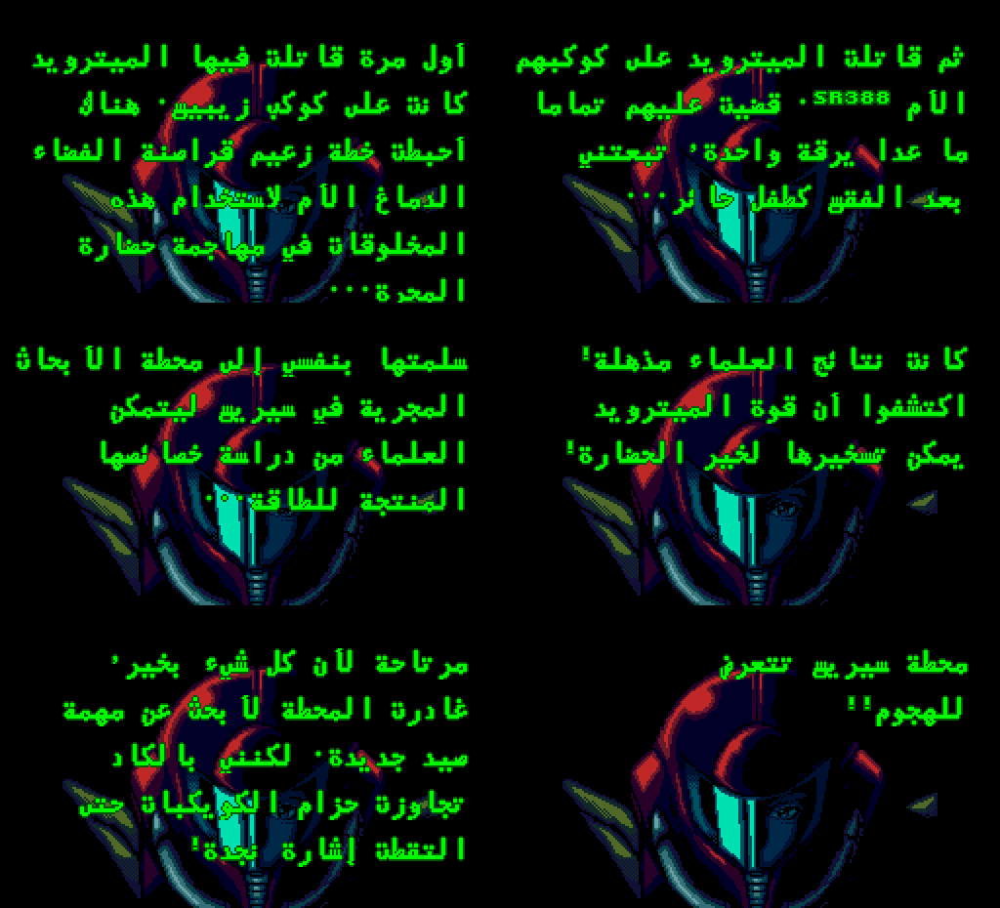
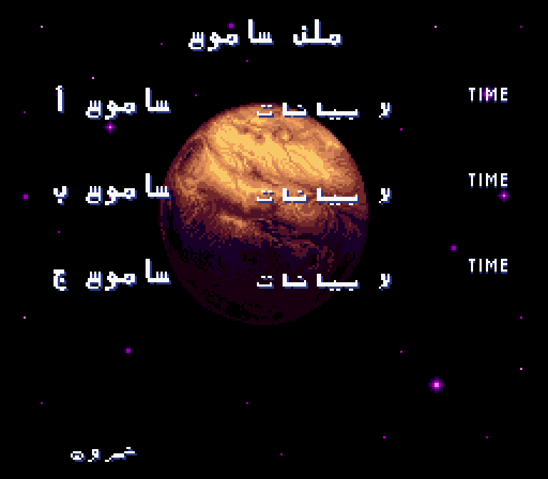
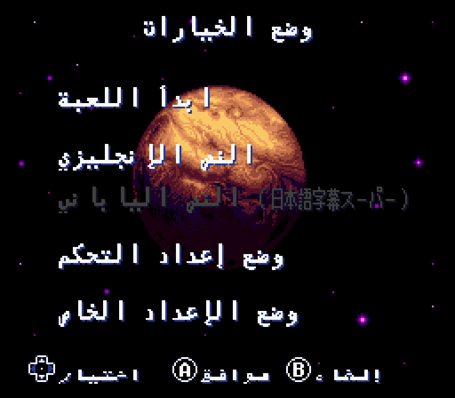
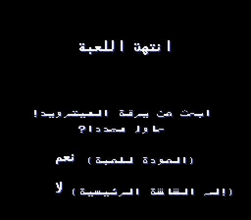
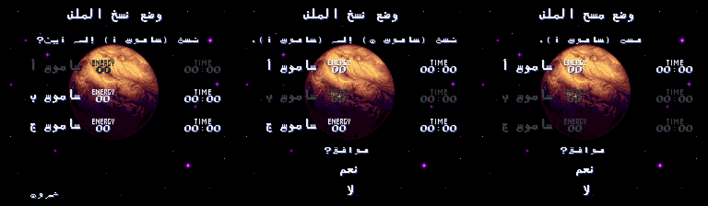
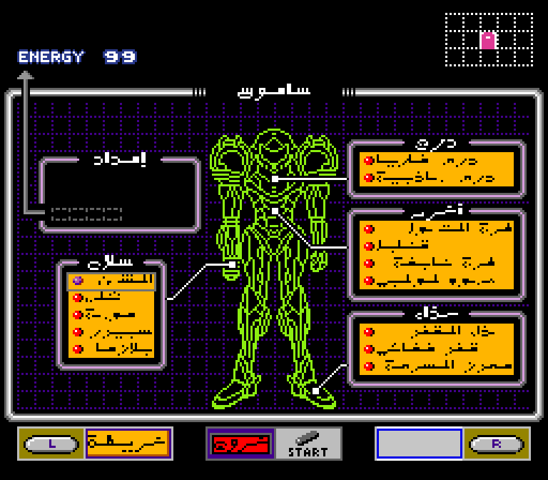
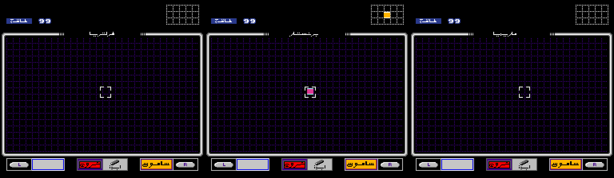

# Super Metroid Arabic Translation

## تعريب Super Metroid إلى العربية

[العربية](#العربية) · [English](#english)

**صانع التعريب · Translation by: Mr S**



---

## العربية

تعريب لأغلب نصوص لعبة **Super Metroid** (SNES) إلى العربية، مع كتابة من اليمين إلى اليسار وتشكيل الحروف المتصلة (أول الكلمة ووسطها وآخرها)، بدون تعديل اللعبة نفسها: يُوزَّع **ملف رقعة BPS** فقط (يشير إلى نسختك الأصلية ولا ينسخ منها)، وتطبّقه أنت على نسختك الأصلية.

### ما المُعرَّب
- رسائل الصناديق (جمع العناصر والحفظ…) وأوصافها، وأزرار نعم/لا
- شاشة اختيار الملفات وقوائمها وحوارات النسخ والمسح (مع حرف الملف أ/ب/ج)
- شاشات OPTION MODE الخمس
- قصة المقدمة كاملة (7 صفحات)
- شاشة GAME OVER
- شاشة التوقف: التسميات وأسماء العناصر الـ14 وأزرار الخريطة (START/EXIT/MAP/SAMUS) وأسماء المناطق السبعة وصندوق الخزان الاحتياطي (الوضع آلي/يدوي)
- عنوان شاشة الخريطة التي تظهر عند تحميل ملف محفوظ (كوكب زيبيس)
- الواجهة أثناء اللعب (طاقة · آلي)

### ما لم يُعرَّب (عمداً)
شعار شاشة العنوان · سطور النهاية الأربعة (مرسومة بسبرايتات) · أسماء المطورين في الكريديت · حرفا **L** و**R** (اسما زرّي الكتف) · نص الوضع الياباني.
بحسب جردي، المُعرَّب **99.6٪ من حجم النص المحصور** (1997 من 2006 أحرف) مع استبعاد البنود أعلاه. هذا رقم عن ما عددتُه فقط، وقد توجد نصوص لم أصل إليها.

### المتطلبات
نسخة **الأصل غير المعدّلة** من اللعبة، **بدون ترويسة (header)**:

| | |
|---|---|
| الاسم | Super Metroid (Japan, USA) (En,Ja) |
| الحجم | 3,145,728 بايت (3 ميغابايت) |
| SHA-1 | `da957f0d63d14cb441d215462904c4fa8519c613` |

> لا يوجد في هذا المستودع أي ملف لعبة، ولن يُضاف. تحصل على نسختك الخاصة بنفسك.

### التطبيق
أي طريقة من هذه:
1. **Flips** أو **MultiPatch** أو **RomPatcher.js** (تطبيق ويب): اختر الـ ROM الأصلية ثم `patch/SuperMetroid_Arabic.bps`.
2. **سكربت بايثون** (يتحقق من الأصل ومن النتيجة):
   ```bash
   python patch/apply_patch.py "Super Metroid (Japan, USA) (En,Ja).sfc" patch/SuperMetroid_Arabic.bps "Super Metroid Arabic.sfc"
   ```
   النتيجة الصحيحة: SHA-1 `27758c9ce3075411f10c34b1bb9a72f6145dc812`، والمجموع الاختباري للـ SNES صالح.

إن كانت نسختك بترويسة نسخ (512 بايت زائدة) أزلها أولاً.

### التشغيل
اختُبر في **Mesen 2** (تشغيل آلي وفحص بالصور). لم يُجرَّب على جهاز حقيقي ولا على محاكيات أخرى. لم أعدّل كود الحفظ ولا تنسيقه، لكن لم أختبر ملف حفظ قديم.

### لقطات
| | |
|---|---|
|  |  |
|  |  |
|  |  |

المزيد في [screenshots](screenshots). (لقطة رسائل الصناديق `11_message_preview.png` معاينة مرسومة من بيانات اللعبة وليست تسجيلاً من لعب حقيقي.)

### قيود معروفة
- الخط الصغير (8×8) وخط أسماء العناصر والمناطق المضغوط كثيفان وخشنان على الشاشة الفعلية؛ تحسينهما يدوياً ممكن.
- مؤشر الاختيار في القوائم بقي على اليسار كما في الأصل.
- من شاشات OPTION MODE الخمس، شاشتان (فيهما العناوين اليابانية) تحققتُ منهما من البيانات فقط ولم أرَهما في المحاكي.
- رسائل جمع العناصر فُحصت عبر روتين اللعبة نفسه وتحقق من الذاكرة، ولم أجرّب التقاط عنصر في لعب حقيقي. جولة لعب قصيرة في غرفة Ceres الأولى لم تُظهر أي تشويه.
- في صندوق الخزان الاحتياطي تقع كلمة "وضع" على يسار القيمة (آلي/يدوي)، كترتيب اللعبة الأصلي من اليسار لليمين.
- بعض الكلمات اختصار اضطراراً لضيق الخانات (مثل "سلاح" لـ BEAM و"درع" لـ SUIT).
- **الترجمات بحاجة لمراجعة** (انظر أدناه).

### الإبلاغ عن مشكلة
وجدت نصاً بالإنجليزية أو حرفاً مشوّهاً أو خطأً في الترجمة؟ افتح [Issue جديداً](../../issues/new/choose) واملأ النموذج: مكان الظهور، لقطة شاشة، والمحاكي. **لا ترفق ملف اللعبة أبداً.**

### ساهم في المراجعة
كل النصوص العربية مع أصلها الإنجليزي في [docs/TRANSLATION_REVIEW.md](docs/TRANSLATION_REVIEW.md) ونسخة جدول [docs/translations_review.csv](docs/translations_review.csv). اكتب تصحيحك وافتح Issue أو Pull Request على `data/translations_ar.json`.

### البناء من المصدر
```bash
pip install -r requirements.txt            # Pillow, matplotlib
python smar_cli.py extract  "Super Metroid (Japan, USA) (En,Ja).sfc" data/messages.json
python smar_cli.py build-ar "Super Metroid (Japan, USA) (En,Ja).sfc" data/messages.json data/translations_ar.json out.sfc --relocate
python smar/bps.py "Super Metroid (Japan, USA) (En,Ja).sfc" out.sfc patch/SuperMetroid_Arabic.bps
```
اختبارات الوحدة (تحتاج الأصل في `base/original.sfc` أو في متغير `SMAR_ROM`، وملف `data/messages.json` الناتج عن `extract`):
```bash
python -m unittest discover -s tests -p "test_*.py"
```
تفاصيل تقنية (العناوين وما يُعدَّل أين): [docs/TECHNICAL_NOTES.md](docs/TECHNICAL_NOTES.md).

### الاعتمادات والترخيص
التعريب والأدوات: **Mr S**. توقيعه مكتوب أيضاً داخل الـ ROM الناتجة (نص عادي عند `$B7:FD00` يظهر في أي محرر سداسي).
اللعبة © Nintendo، والمشروع غير تابع لها ولا مصرَّح من جهتها. كود المشروع وبيانات الترجمة تحت [MIT](LICENSE). التفاصيل في [NOTICE.md](NOTICE.md).

---

## English

An Arabic translation of **Super Metroid** (SNES) with right-to-left text and contextual letter shaping. The game is never redistributed: you apply a **BPS patch** (it refers to your copy instead of containing parts of it) to your own copy.

### What is translated
Message boxes (item pickups, save…) and the yes/no prompts · the file-select screen with its copy/clear dialogs (including the Arabic file letter) · the five OPTION MODE screens · the whole intro story (7 pages) · GAME OVER · the pause screens (labels, the 14 item names, map buttons, the 7 area names, the reserve-tank box) · the title of the save-load map screen · the in-game HUD (energy, auto).

### Not translated (on purpose)
Title-screen logo · the four ending story lines (they are sprites) · the staff credits · the shoulder-button letters **L/R** · the Japanese-language text mode.
In my census **99.6 % of the counted text volume** (1997 of 2006 characters) is translated, excluding the items above. The census counts only what I found; there may be text I did not reach.

### You need
The **unmodified, headerless** dump: *Super Metroid (Japan, USA) (En,Ja)*, 3,145,728 bytes, SHA-1 `da957f0d63d14cb441d215462904c4fa8519c613`. No game file is in this repository.

### Applying
- Any BPS patcher (Flips, MultiPatch, the browser-based RomPatcher.js…) with `patch/SuperMetroid_Arabic.bps`, or
- `python patch/apply_patch.py <original.sfc> patch/SuperMetroid_Arabic.bps <output.sfc>` (checks source and result). Expected result SHA-1: `27758c9ce3075411f10c34b1bb9a72f6145dc812`.

### Tested
In **Mesen 2** only (scripted runs and screenshot checks). Not tested on real hardware or other emulators. The save code and format are untouched; I did not test an old save file.

### Known limitations
Dense, rough small fonts · menu cursor stays on the left · two of the five OPTION MODE screens (the ones with Japanese titles) were verified from data only, not seen in the emulator · item-pickup boxes were verified through the game's own routine and memory checks, not by picking up an item in real play (a short real-play walk in the first Ceres room showed no corruption) · some words are abbreviated to fit · **the translations need review**: see [docs/TRANSLATION_REVIEW.md](docs/TRANSLATION_REVIEW.md) / [csv](docs/translations_review.csv) and send corrections as an Issue or a PR on `data/translations_ar.json`.

### Reporting a problem
Found untranslated text, a garbled glyph or a wrong translation? [Open an issue](../../issues/new/choose) and fill in the form: where it appears, a screenshot, and your emulator. **Never attach the game file.**

### Building / tests
See the commands in the Arabic section above (`extract`, `build-ar`, `smar/bps.py`, `unittest`). Technical notes: [docs/TECHNICAL_NOTES.md](docs/TECHNICAL_NOTES.md).

### Credits and license
Translation and tools by **Mr S**; the same mark is written as plain text inside the patched ROM (`$B7:FD00`, visible in any hex editor).
Super Metroid © Nintendo; this project is not affiliated with or endorsed by Nintendo. Code and translation data: [MIT](LICENSE). See [NOTICE.md](NOTICE.md).
